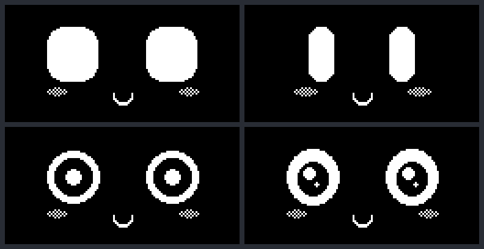
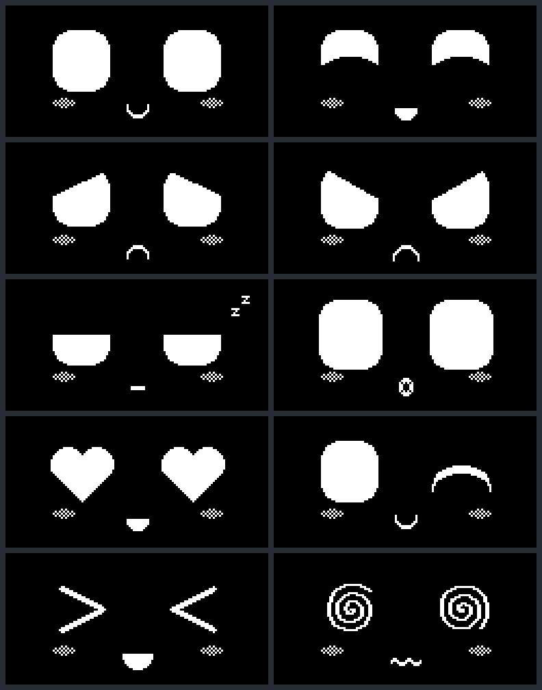
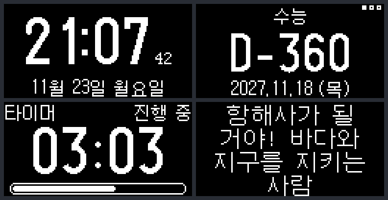

# ESP32-C3 OLED 로봇 얼굴 리모컨 (BLE + 웹앱)

ESP32-C3 + SH1106 1.3인치 OLED(128×64, I2C)에 **귀여운 로봇 얼굴·시계·디데이·타이머·스톱워치·메시지**를 띄우고,
스마트폰 웹앱에서 블루투스(BLE)로 바꾸는 프로젝트입니다.





> 위 그림은 실제 펌웨어 그리기 코드(`face.h`, `screens.h`)를 PC에서 U8g2 라이브러리로 그린 화면입니다.

```
firmware/esp32c3_oled_ble/
  esp32c3_oled_ble.ino   ← 메인 코드 (블루투스, 설정 저장, 명령 처리)
  face.h                 ← 로봇 얼굴 애니메이션
  screens.h              ← 시계·디데이·타이머·스톱워치·메시지 화면
docs/
  index.html             ← 스마트폰 웹앱
  faces.js               ← 앱에 보이는 얼굴 미리보기 이미지
```

## 1. 배선

| OLED | ESP32-C3 |
|------|----------|
| VCC  | 3V3      |
| GND  | GND      |
| SDA  | GPIO 8   |
| SCL  | GPIO 9   |

다른 핀에 연결했다면 `esp32c3_oled_ble.ino` 위쪽 `I2C_SDA`, `I2C_SCL`을 바꾸세요.

## 2. 펌웨어 업로드 (Arduino IDE 2.x)

1. **보드 매니저**에서 `esp32 by Espressif Systems` 설치
2. **라이브러리 매니저**에서 `U8g2` (by oliver) 설치
3. `esp32c3_oled_ble.ino`를 열면 `face.h`, `screens.h`가 탭으로 같이 열립니다 (세 파일이 같은 폴더에 있어야 함)
4. 보드: `ESP32C3 Dev Module`
5. ⚠️ **Tools → Partition Scheme → `Huge APP (3MB No OTA/1MB SPIFFS)`**
   한글 폰트와 블루투스 때문에 프로그램이 커서, 기본 설정이면 `Sketch too big` 오류가 날 수 있어요.
6. (Super Mini 보드) 시리얼 모니터를 쓰려면 **USB CDC On Boot → Enabled**
7. 업로드

화면이 안 나오면 `OLED_I2C_ADDR`를 `0x3D`로 바꿔 보세요.

## 3. 웹앱 열기

웹 블루투스는 **https 주소**에서만 됩니다. GitHub Pages(무료)를 쓰면 됩니다.

1. 저장소 **Settings → Pages**
2. Source `Deploy from a branch` → 브랜치 선택, 폴더 `/docs` → Save
3. **Custom domain은 비워 두기** (도메인을 사지 않았다면 입력하면 안 열려요)
4. `https://<아이디>.github.io/<저장소이름>/` 을 스마트폰에서 열기

| 스마트폰 | 브라우저 |
|---------|---------|
| 안드로이드 | **Chrome** (블루투스·위치 권한 허용) |
| 아이폰 | Safari는 미지원 → **Bluefy** 앱 |

## 4. 앱 사용법

- 맨 위 **OLED 화면** 줄: 누르면 OLED가 바로 그 화면으로 바뀝니다 (얼굴/시계/디데이/타이머/스톱워치/메시지/자동 순환).
- 아래 탭은 각 기능의 **설정**입니다.

| 탭 | 할 수 있는 것 |
|----|---------------|
| 🤖 얼굴 | 눈 모양 4종, 표정 10종(미리보기 그대로 OLED에 나옴), 입·볼터치 켜고 끄기, 자동 두리번, 눈동자 조종 패드 |
| 📅 디데이 | 디데이 3개 저장(제목+날짜). OLED에서 4초마다 번갈아 표시 |
| ⏳ 타이머 | 타이머(프리셋/직접 입력, 종료 시 폰 진동), 스톱워치 |
| 💬 메시지 | 한글 메시지 표시, `|`로 줄바꿈 |
| ⚙️ 설정 | **자동 순환**(번갈아 보여줄 화면과 간격 선택), 24시간제, 시간 맞추기, 밝기, 화면 뒤집기 |

설정(얼굴, 디데이, 메시지, 자동 순환, 밝기 등)은 보드에 저장돼서 **전원을 껐다 켜도 유지**됩니다.
시간은 보드에 배터리가 없어 유지되지 않으므로, 앱을 연결하면 자동으로 맞춰집니다.

## 5. 통신 규칙 (기능을 직접 추가할 때)

Nordic UART Service UUID(`6e400001-…`)를 써서 **nRF Connect** 앱으로도 테스트할 수 있어요.
RX 특성(`6e400002-…`)에 텍스트 한 줄을 씁니다. (앱은 20바이트씩 나눠 보내고 끝에 `\n`을 붙임)

```
MODE:EYES|CLOCK|DDAY|TIMER|STOPWATCH|TEXT|CYCLE
EYE:NORMAL|HAPPY|SAD|ANGRY|SLEEPY|SURPRISED|LOVE|WINK|LAUGH|DIZZY
STYLE:0~3   MOUTH:0|1   BLUSH:0|1   AUTO:0|1   LOOK:-50,20   BLINK
DDAY:0,2027-11-18,수능     DDAY:DEL,0
TIMER:SET,300 | TIMER:START | TIMER:PAUSE | TIMER:RESET     SW:START | SW:STOP | SW:RESET
TEXT:안녕하세요     CYCLE:10,7  (10초마다, 비트마스크 7 = 얼굴+시계+디데이)
TIME:<epoch초>,<UTC오프셋분>   BRIGHT:0~255   FLIP:0|1   H24:0|1   GET(설정 요청)
```

새 화면을 만들려면 `screens.h`에 그리기 함수를, `.ino`의 `Mode`와 `render()`에 한 줄을 추가하면 됩니다.

## 참고

- 한글은 U8g2의 `gulim12_t_korean2`, `unifont_t_korean2` 폰트를 씁니다. 자주 쓰는 한글 위주라 드문 글자는 안 보일 수 있어요.
- 앱의 얼굴 미리보기는 입·볼터치를 켠 상태 기준입니다.
